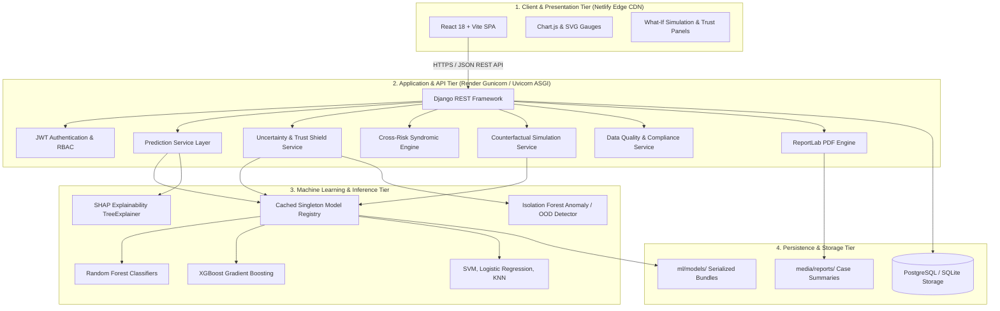

# System Architecture & Technical Specification

## 1. Architectural Overview

The **Multi-Disease Prediction and Clinical Decision Support System** follows a clean, decoupled, four-tier enterprise architecture engineered for high availability, zero-state horizontal scalability, and strict clinical decision explainability.

---

## 2. Layer-by-Layer Architectural Breakdown

### 2.1 Presentation Tier (React 18 + Vite)
- **Deployment Target:** Netlify Edge Network
- **Design Tokens:** Medical-grade blue palette (`#2563EB`), emerald (`#10B981`) for low risk/healthy, amber (`#F59E0B`) for cautionary boundaries, and crimson (`#DC2626`) for critical red flags.
- **Key Modules:**
  - Multi-step diagnostic inputs with physiological range clamps and instant data quality feedback.
  - Interactive Radial Confidence Rings color-coded to risk level.
  - Explainable AI horizontal attribution charts breaking down SHAP feature drivers.
  - Dynamic Counterfactual What-If sliders showing before/after probabilities.
  - Multi-Organ Cross-Risk Radar visualization.

### 2.2 Application Service Tier (Django REST Framework)
- **Deployment Target:** Render Web Service (Python 3.11 ASGI via Uvicorn/Gunicorn).
- **Statelessness:** Inference endpoints maintain no in-memory session state, allowing dynamic auto-scaling across Render container replicas.
- **Service Layer Pattern:** Views handle request validation and HTTP status codes; all clinical logic, uncertainty computations, and model orchestrations are encapsulated in isolated services (`apps/*/services.py`).

### 2.3 Machine Learning & Inference Tier
- **Model Registry (Cached Singleton Pattern):** Models and feature scalers are loaded lazily upon first access and retained in shared memory, preventing costly disk deserialization on subsequent requests.
- **Ensemble Benchmarking:** 7 algorithms evaluated per disease (`RandomForest`, `XGBoost`, `LogisticRegression`, `SVM`, `KNN`, `DecisionTree`, `NaiveBayes`) with hyperparameter optimization via 5-Fold Stratified Cross-Validation.
- **Explainability:** SHAP (`TreeExplainer` and `LinearExplainer`) computes exact Shapley feature attributions.

### 2.4 Data & Persistence Tier
- **Database:** PostgreSQL on Render for production; SQLite for local offline development.
- **Indexed Schema:** Historical prediction and PDF report tables utilize composite indexes on `(user_id, created_at)` and `(disease_type, created_at)` for fast timeline queries.
