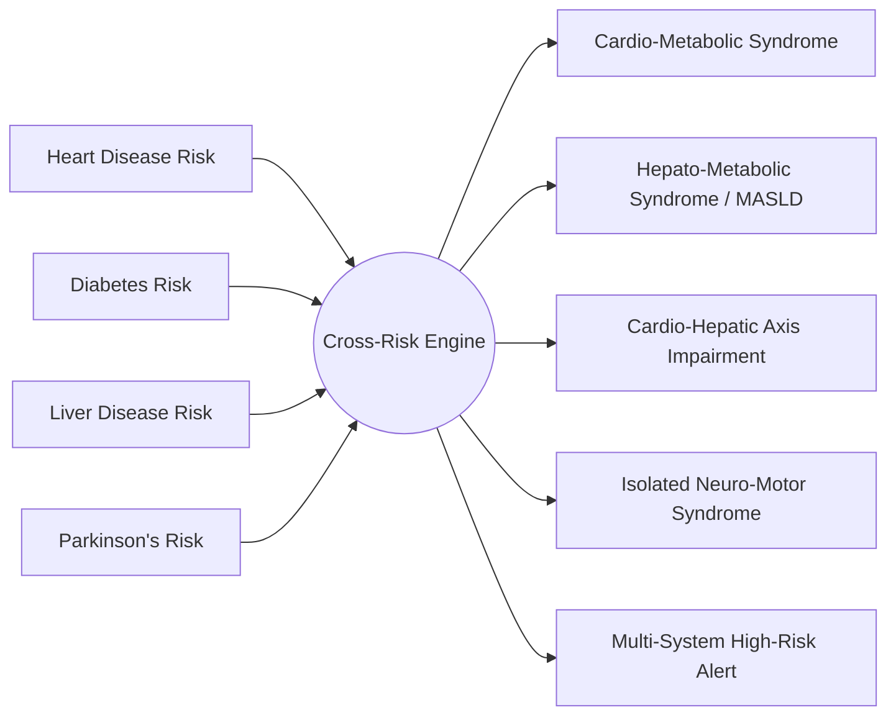

# Feature 3: Multi-Disease Cross-Risk Engine

## 1. Clinical Syndromic Clustering

Chronic metabolic, vascular, and organ disorders rarely occur in isolation. Rather, pathology in one system often triggers or accelerates decompensation in another:

- **Insulin Resistance** simultaneously elevates blood glucose (Diabetes), promotes hepatic steatosis (MASLD / Liver Disease), and accelerates arterial atherosclerosis (Heart Disease).
- **Hypertension** damages both cardiac myocytes and vascular endothelium, compromising renal and systemic perfusion.

The **Cross-Risk Engine** evaluates multi-disease predictions jointly to detect multi-organ syndromes:

---

## 2. Recognized Syndromic Patterns

| Cluster Identifier | Triggers & Clinical Thresholds | Triage Priority | Referral Specialties |
| :--- | :--- | :--- | :--- |
| **Cardio-Metabolic Syndrome** | Heart Probability $> 0.50$ AND Diabetes Probability $> 0.50$ | **HIGH** | Cardiologist & Endocrinologist |
| **Hepato-Metabolic Syndrome (MASLD)** | Liver Probability $> 0.50$ AND Diabetes Probability $> 0.50$ | **HIGH** | Hepatologist & Endocrinologist |
| **Cardio-Hepatic Axis Impairment** | Heart Probability $> 0.55$ AND Liver Probability $> 0.55$ | **HIGH** | Cardiologist & Gastroenterologist |
| **Multi-System High-Risk Alert** | 3 or more disease modules with Probability $> 0.55$ | **EMERGENCY** | Internal Medicine Hospitalist |
| **Isolated Neuro-Motor Syndrome** | Parkinson's Probability $> 0.60$ with other modules normal | **MEDIUM** | Movement Disorder Neurologist |

---

## 3. Radar Chart Visualization & Patient Routing

The engine compiles normalized risk scores $[0, 100]$ across all four anatomical domains:
- **Cardiovascular Health Axis**
- **Metabolic / Glycemic Axis**
- **Hepato-Biliary Axis**
- **Neuro-Vocal Biomarker Axis**

Rendered via Chart.js Polar Radar, clinicians can view multi-organ balance at a single glance.
